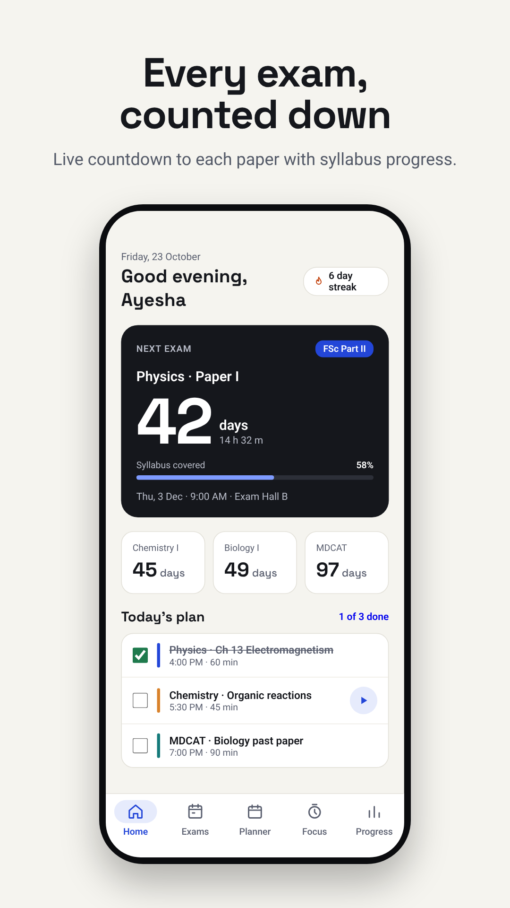

# Exam Clock — exam countdown & revision planner (Android, Kotlin)

A native Android app (Kotlin + Jetpack Compose, Material 3) that counts down to every exam paper,
builds a revision timetable automatically, runs a focus timer and shows whether the student is on
track. Exams are organised **country by country** (25 countries + international exams), with each
country's local weekend used by the planner.



## Build setup (pinned)

| | Version |
|---|---|
| Android Studio | Quail 4 (2026.1.4), Windows 11 |
| Android Gradle Plugin | 9.4.0 — **built-in Kotlin** (no `org.jetbrains.kotlin.android`) |
| Gradle (wrapper) | 9.6.0 |
| Gradle JDK | 21 (bytecode target 17) |
| compileSdk / targetSdk / minSdk | 37 / 36 / 26 |
| Kotlin (KGP + Compose compiler plugin) | 2.4.21 — `kotlin { compilerOptions { } }`, no `kotlinOptions` |
| KSP | 2.3.12 (Room; no kapt) |
| Compose BOM | 2026.09.00 (Compose 1.12, Material 3 1.4) |
| AndroidX | core 1.19.1, splashscreen 1.2.0, activity 1.13.0, fragment 1.9.1, lifecycle 2.11.0, navigation 2.10.2, room 2.8.5, datastore 1.3.0, work 2.12.0 |
| Google | play-services-ads 25.5.0, user-messaging-platform 4.0.0 |
| Images | Coil 3.6.3 (used for native-ad icons; no manual bitmap decoding anywhere) |

All versions live in `gradle/libs.versions.toml`. Open the `ExamClock/` folder in Android Studio,
let it sync, then run the `app` configuration. Unit tests: `./gradlew :app:testDebugUnitTest`.

## Features

- **Animated splash** — Android 12+ system splash with an animated vector icon, followed by an in-app
  animation (ring fills, tick draws, name rises in).
- **Get-started guide** — 4 illustrated pages, then a 3-step setup: country → exams → daily goal &
  reminders. The country is pre-selected from the SIM/network/locale (no permission needed).
- **Country exam catalog** — boards, entry tests and international exams (IGCSE, A Level, IB, SAT,
  IELTS, TOEFL, GRE, GMAT…). Picking an exam adds one entry per paper. Dates are never invented:
  the student copies them from the official date sheet, and undated papers are flagged on Home.
- **Live countdown** — days/hours/minutes/seconds to the next paper, mini countdowns for the rest.
- **Syllabus tracking** — paste a topic list (one per line), tap to move each topic through
  Not started → Learning → Revising → Done, rate confidence 1–5, see readiness % and the pace needed.
- **Auto plan** (`domain/PlanGenerator.kt`, unit-tested) — fits sessions into the daily budget
  (school days vs the country's weekend), skips rest days, works around sessions the user added,
  gives each slot to the most urgent exam, learns unstarted/weak topics first, schedules spaced
  revision (1, 3, 7, 14, 30 days), reserves the last N days before each exam for past papers, never
  schedules a subject on/after its exam date, and reports topics that will not fit.
- **Planner** — week strip, day timeline, add/delete/tick sessions; ticking a session logs its time.
- **Focus timer** — Pomodoro with short/long breaks; the end time is persisted so it survives the app
  being closed, completion is logged exactly once, an inexact alarm notifies in the background
  (no exact-alarm permission, no foreground service).
- **Progress** — minutes per day vs goal, streak and best streak, readiness per exam, pace warnings,
  time per exam.
- **Reminders** — one daily reminder (WorkManager) and one-time alerts 30/14/7/3/1 days before each
  exam; notification permission is asked in context during setup.
- **Exit dialog** — Back on Home shows *Cancel · Rate us · Exit*. Rate us opens the Play listing.
- Light/dark/system theme, edge-to-edge (`enableEdgeToEdge()` + insets only), RTL-ready layout,
  locale-aware dates, times and first day of week, TalkBack labels.

## Ads (AdMob)

IDs are set in `app/build.gradle.kts`. **Debug builds always use Google's test ad units**; release
builds use the real ones:

| Format | Unit |
|---|---|
| App ID | `ca-app-pub-1948347222012540~3770782014` |
| Banner | `ca-app-pub-1948347222012540/8827667574` |
| Interstitial | `ca-app-pub-1948347222012540/4888422563` |
| Native | `ca-app-pub-1948347222012540/6309229724` |

- **Consent first**: Google UMP runs on every launch; ads are requested only when `canRequestAds()`
  is true. A *Settings › Ad privacy choices* entry appears where the law requires it.
- **Banner** (anchored adaptive, above the bottom navigation on Home/Exams/Planner/Progress):
  if the first 2 load calls fail, every further call waits **15 s**; after a successful load the
  SDK's refresh takes over. It takes no space until an ad is showing.
- **Interstitial**: shown only after major actions — saving a new exam, adding exams from the
  catalog, generating a plan (on "View plan"), finishing a focus session. Capped at **1 per 30 s**
  (from when the last one closed). Never at app start, never on exit, never mid-task.
- **Native**: placed in free space between sections (Home, Exams list, Exam detail, Planner,
  Progress), labelled **Ad**, with AdChoices and MediaView; nothing is drawn until an ad loads.
- Ad content is limited to **Teen (T)** rating. No ads on the splash, guide, setup, focus timer or
  exit dialog.

## Before publishing on Google Play

1. **Privacy policy URL** — host `PRIVACY_POLICY.md` (e.g. GitHub Pages) and add the link in Play
   Console. The same text is in the app.
2. **app-ads.txt** — on the website listed in your Play developer account add:
   `google.com, pub-1948347222012540, DIRECT, f08c47fec0942fa0`
3. **Target audience** — choose **13+** (or older). Choosing under-13 brings in the Families policy,
   which needs child-directed ad settings.
4. **Data safety form** — declare: Device or other IDs (advertising ID) *collected and shared* for
   advertising/analytics by the AdMob SDK; data encrypted in transit; study data stays on device.
   Answer **Yes** to "uses advertising ID" (the Ads SDK adds the `AD_ID` permission).
5. **Ads declaration** — "Contains ads: Yes".
6. **Signing** — create an upload key in Android Studio (*Build › Generate Signed App Bundle*);
   keystores are git-ignored.
7. **Screenshots** — `store-assets/` has a 512×512 icon (32-bit PNG), a 1024×500 feature graphic
   and six 1080×1920 promo screenshots made from the design mockups. Replace the phone images with
   real screenshots from a device before release so the listing matches the app exactly.

## Project layout

```
app/src/main/kotlin/com/devatjunaid/examclock/
  ads/            consent + SDK init, banner (retry cap), interstitial (30 s cap), native card
  data/catalog/   country → exam templates
  data/db/        Room entities & DAOs
  data/prefs/     DataStore settings + persisted focus timer
  data/repo/      StudyRepository (single data entry point)
  domain/         PlanGenerator, readiness, streaks, countdown, ad policies (pure Kotlin, tested)
  notifications/  channels, daily reminder worker, focus alarm
  ui/             Compose screens, navigation, theme
app/src/test/     JVM unit tests for the domain layer
store-assets/     Play Store icon, feature graphic, screenshots
```
