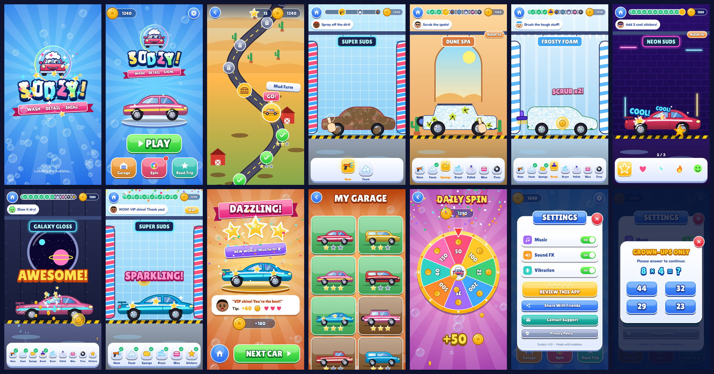

# Sudzy! — Wash • Detail • Shine

A bubbly car wash and detailing game for Android, written in Kotlin. Everything is drawn in code:
cars, the mascot, logo, icons, backgrounds and particles. Every sound and both music loops are
synthesised by `tools/make_sounds.py`. No stock art, no licensed audio.



## What's in it

* **Animated splash**: a bubble rises from a foam puddle, pops open to reveal Sudzy (the googly-eyed
  mascot car), the foam-capped letters bounce in one by one, the ribbon snaps in, sparkles burst, and
  a wall of foam wipes you to the home screen ([gif](docs/screenshots/splash_animation.gif)).
* **30 hidden stages**: 6 worlds × 5 cars, shown only as a road-trip map with no numbers anywhere.
  Each stage adds a little more:
  | World | New fun |
  |---|---|
  | Sunny Suburbs | hose, foam, sponge, dryer, wax, first stickers on the finale |
  | Mud Farm | thick mud (more passes), tire shine, golden bonus bubbles |
  | Dune Desert | sand + bug splats, scratch polishing, *Rush hour* tips |
  | Frosty Peaks | snow and ice, tough spots that need the brush |
  | Neon City | glowing slime and graffiti, stickers on every car |
  | Galaxy Garage | cosmic goo, monster trucks, rocket cars and alien VIPs |
* **Juice**: combo text (`SPLASH x7!`), screen shake, coin bursts, confetti, a gleam sweep on the
  finished car, happy customers with tips, star ratings, haptics.
* **Extras**: garage collection with mystery silhouettes, a free daily prize wheel (coins only, no
  purchases), and a settings screen with Music / Sound FX / Vibration toggles plus **Review this app**,
  Share, Contact support and Privacy policy. Those last four sit behind a grown-ups-only gate.

## Ads (AdMob) and the Families policy

All ad code is in `app/src/main/java/com/sudzy/carwash/ads/`.

| Format | When it shows |
|---|---|
| Anchored adaptive **banner** | Always, in its own strip at the bottom, never over gameplay |
| **Interstitial** | Each time a new level starts (`Game.startLevel`). The very first wash a new player plays is skipped so the tutorial isn't interrupted |
| **App open** | Only when the player returns to the game from the background. Never on a cold start or first launch, never right after one of our own ads or links, never on top of another ad |

Child-directed setup (Google Play Families / COPPA / GDPR):

* `RequestConfiguration` sets `TAG_FOR_CHILD_DIRECTED_TREATMENT_TRUE`, `TAG_FOR_UNDER_AGE_OF_CONSENT_TRUE`
  and `MAX_AD_CONTENT_RATING_G`. This happens in `Application.onCreate`, before any request.
* The UMP consent request is tagged under-age-of-consent.
* `com.google.android.gms.permission.AD_ID` is removed in the manifest.
* Outside links are behind a parental gate.

**Before publishing:**

1. Replace the **test** IDs in `ads/AdsConfig.kt` and `admobAppId` in `app/build.gradle.kts` with your own.
2. In AdMob, mark the app as child-directed (*App settings → Child-directed treatment*) and restrict
   ad categories as needed.
3. In Play Console, complete *Target audience and content* and the *Families* declarations.
4. Set your support email and privacy policy URL in `AppLinks` (bottom of `MainActivity.kt`).

## Building

Open the `SudzyGame` folder in Android Studio (Narwhal or newer) and press Run, or:

```
./gradlew assembleDebug
```

* AGP 8.10.1 · Kotlin 2.1.21 · Gradle 8.14.3
* compileSdk / targetSdk 36 · minSdk 24
* Dependencies: `play-services-ads` 24.4.0 and `user-messaging-platform` 3.2.0. Bump these if
  Android Studio suggests newer versions.

Store assets are in `store/` (512 px icon and 1024×500 feature graphic). Regenerate the sounds with
`python3 tools/make_sounds.py`.

## Code map

```
engine/   Game loop, scenes, foam-wipe transitions, particles, buttons, save data, audio
art/      Car models, Sudzy mascot + logo, icons, faces, world backdrops, stickers
game/     Level definitions (30 stages) and the paintable dirt / foam / wax layers
scenes/   Splash, Home, Road-trip map, Wash, Reward, Garage, Daily spin, Settings overlay
ads/      AdMob: consent, banner, interstitial, app-open
```
