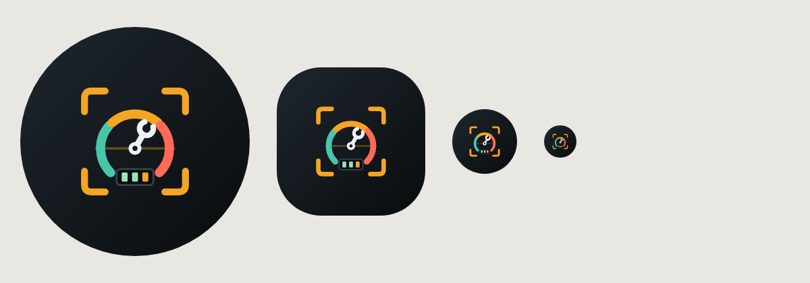

# OdoMate: Car Maintenance Log (Android, Kotlin)

Snap your odometer and get reminders before every service is due.

Built with Kotlin, Jetpack Compose (Material 3), Room, DataStore, WorkManager, CameraX, ML Kit text recognition and Google AdMob.



## Features

**Odometer**
- **Read the odometer from a photo.** A live camera scan with on-device ML Kit OCR picks the odometer number out of speed, rpm, clock and trip readings. It locks on once the same number has been seen several times, and you can fix any digit before saving.
- You can also scan a photo from the gallery, or type the reading.
- Sanity checks catch mistakes: a reading lower than the last one, a suspiciously large jump, or a likely trip-meter decimal.

**Reminders**
- **15 maintenance services out of the box:** engine oil & filter, engine air filter, cabin air filter, spark plugs, tire rotation, wheel alignment, brake pads, brake fluid, coolant, transmission fluid, battery check, wiper blades, insurance renewal, registration/road tax and annual inspection (off by default).
- Each service can be due by distance, by time, or by whichever comes first.
- Every interval and reminder threshold can be edited, and you can add your own custom services with an icon.
- Status is shown as *Overdue / Due soon / On track / Not set up*, with progress meters.
- A "due around <date>" estimate is projected from your average daily driving.
- **Notifications:** a daily background check sends one alert when a service becomes "due soon", another when it becomes "overdue", and repeats overdue alerts weekly. There is also an optional weekly "snap your odometer" nudge.
- Tapping a notification opens that service directly.

**Logging**
- **Log a service:** pick several services done in one visit, with date, odometer (scan or type), cost, shop, notes and a receipt photo. Saving resets every selected reminder.
- Editing or deleting a log entry recalculates the reminders automatically.
- **Fuel log** *(extra)*: fill-ups with volume, cost, price per unit and a full-tank flag. Fuel economy is calculated from one full tank to the next.

**History & data**
- **History:** a timeline of services, fill-ups and odometer scans, plus yearly spend, number of services, distance driven and a monthly distance chart.
- **Multiple vehicles** *(extra)*: a garage switcher, where each car has its own odometer, services and history.
- **Data** *(extra)*: CSV export to share with your mechanic or open in a spreadsheet, plus a JSON backup and restore to a file.

**Settings**
- km/mi, litres/gallons, currency symbol, and Dark/Light/System theme.
- Reminder time, test notification, Rate, Share and Privacy policy links.

### Ads (AdMob)
| Format | Where |
|---|---|
| **Adaptive banner** | Bottom of every main screen, above the navigation bar. Hidden on the camera, on onboarding and while the keyboard is open. |
| **Interstitial** | After the key actions: saving an odometer reading (scan or typed), logging or editing a service, saving a fill-up, CSV export and backup. Shown at most once every 60 seconds, always *after* the action has finished. |
| **Native** | Home (below "Up next"), Services list (between sections), History (below the summary), More/Settings (medium), and the **exit popup** (medium). Collapses to nothing if no ad loads. |

The Google UMP consent form appears where required (EEA/UK). Ads only load after consent allows them, and an "Ad privacy choices" entry appears in Settings when needed.

### Splash & exit
- The animated splash plays an instrument-cluster intro: the scan brackets lock on, the three-colour gauge sweeps, the wrench needle swings into place and the odometer rolls. It is not a static logo. The Android 12+ system splash is reduced to the plain background so the two blend together.
- The exit popup, shown on Back from Home, has a native ad, a reminder about any services that need attention, Stay/Exit buttons and a Rate link.

### Logo
The adaptive icon (with a themed-icon monochrome layer) combines several graphics:
- camera scan brackets (photo reading)
- a three-colour gauge (on track / due soon / overdue)
- a wrench-shaped needle (maintenance)
- an odometer digit window

The source is in `art/logo.svg`, and the 512×512 Play Store icon is in `art/play_store_icon_512.png`.

## Build

1. Open the `car-maintenance-log` folder in Android Studio (Ladybug or newer). JDK 17+.
2. Let Gradle sync, then run the `app` configuration. Or from the command line: `./gradlew assembleDebug`
3. Unit tests: `./gradlew test` (covers the odometer parser).

## Before publishing

1. **AdMob IDs:** put your real IDs in `gradle.properties` (`ADMOB_APP_ID`, `ADMOB_BANNER_ID`, `ADMOB_INTERSTITIAL_ID`, `ADMOB_NATIVE_ID`). Debug builds always use Google's test IDs. Release builds use these values, which default to the test IDs until you change them.
2. **Privacy policy:** set `PRIVACY_POLICY_URL` in `ui/settings/SettingsScreen.kt`. Google Play requires one for apps that use AdMob and the camera.
3. **Package name:** change `applicationId`/`namespace` (`com.odomate.app`) if you want a different one.
4. **Signing:** create a release keystore in Android Studio (Build → Generate Signed Bundle).
5. In the AdMob console, set up the **consent message** (Privacy & messaging → GDPR) so the UMP form appears for EEA users.

## Project layout

```
app/src/main/java/com/odomate/app/
  ads/          AdsManager (UMP consent, SDK init, interstitial pacing), Banner + Native composables
  data/         Room entities/DAOs, repository, settings (DataStore), templates, backup/CSV
  domain/       Due-date/status calculation, stats, fuel economy (pure Kotlin)
  ocr/          Odometer parser (pure Kotlin, unit-tested) + CameraX/ML Kit analyzers
  reminders/    WorkManager daily worker, scheduler, notifications
  ui/           Compose screens: splash, home, services, scan, log, fuel, history, vehicles, settings, exit
```

Fonts: Archivo and JetBrains Mono (SIL Open Font License), bundled in `res/font`.
