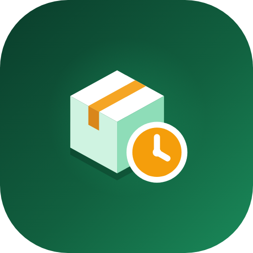

# ShelfGuard — shop inventory & expiry alerts (Android, Kotlin)

A native Android app for small shops: track stock, catch expiring products before
they go to waste, and get warned when something runs low.



Built with Kotlin, Jetpack Compose (Material 3), Room, WorkManager, DataStore,
Google ML Kit barcode scanning and Google AdMob.

## Features

**Inventory**
- Add, edit and delete products (name, category, barcode, unit, cost and selling
  price, supplier, notes). Deleting from the list shows an **Undo** snackbar.
- Stock is kept in **batches**, each with its own expiry date, so one product can
  hold old and new stock at once. Tap a batch to correct its quantity or date, or
  remove it.
- **Record sale**: stock is taken from the batch that expires first (FIFO by expiry),
  and expired stock is never sold.
- **Restock**: adds a batch (or tops up a batch with the same expiry date) and can
  update the cost price.
- Search by name, category, supplier or barcode; filter by Low stock / Expiring /
  Expired / Out of stock; sort by name, expiry, quantity or date added.
- **Barcode scanning** (Google code scanner — no camera permission needed): scan to
  find a product, or to fill in the barcode when adding one. Duplicate barcodes are
  rejected.

**Alerts**
- Per-product expiry warning window (e.g. 7 days before) and low-stock level.
- Alerts screen grouped into Expired, Expiring soon, Out of stock and Low stock, with
  one-tap **Remove expired** (logged as waste) and **Restock**.
- **Daily summary notification** at a time you choose (WorkManager), plus an instant
  notification when a sale pushes a product to its minimum or sells it out.
- Notification permission is requested on Android 13+.

**Dashboard & reports**
- Dashboard: product count, low-stock / expiring / expired tiles (tap to filter),
  stock value at cost and retail, a "Needs attention" list and quick actions.
- Reports for 7 / 30 / 90 days: revenue, profit, units sold, waste value, restocked
  units, a revenue bar chart and top sellers.
- **Export inventory as CSV** through the share sheet.

**App polish**
- Animated splash: the Android 12+ system splash hands over seamlessly to an animated
  Compose splash (tile springs in, box faces slide together, tape seals the lid, the
  clock badge pops and its hand sweeps, the name types in).
- Custom logo: an isometric stock box sealed with amber tape, guarded by an amber
  clock badge (stock + expiry). Adaptive launcher icon with themed (monochrome) icon
  and a matching notification icon.
- Branded **exit dialog** when pressing Back on the home screen.
- Light and dark themes; settings for shop name, currency symbol, alert time and
  defaults; delete-all-data option. Everything is stored on the device.

## Ads (AdMob)

| Format | Where | Rules |
|---|---|---|
| Banner (anchored adaptive) | Bottom of every screen except the product editor | Hidden in the editor so it never sits next to the Save button |
| Interstitial | Opening **Stock** or **Reports** from the tab bar, the dashboard tiles/quick actions, and after saving a product | Not in the first 30 s of a session, max once every 90 s, never right after another full-screen ad. Navigation always continues after the ad closes (or straight away if none is ready) |
| Native (compact) | End of the Dashboard, end of Reports, and inside the exit dialog | Small icon + headline + one line + button, shown only once an ad has loaded |
| App open | Only when the app comes back from the background | **Never on the first (cold) open.** Not shown over the splash, right after another full-screen ad, or when returning from an ad click, the barcode scanner or the share sheet. Ads expire after 4 h |

Consent for EEA/UK users is handled with Google's User Messaging Platform (UMP)
before any ad is requested. A "Ad privacy choices" entry appears in Settings when
required.

### Using your own AdMob IDs

Debug builds **always** use Google's test ads. For release builds, put your IDs in
`gradle.properties`:

```properties
ADMOB_APP_ID=ca-app-pub-xxxxxxxxxxxxxxxx~yyyyyyyyyy
ADMOB_BANNER_ID=ca-app-pub-xxxxxxxxxxxxxxxx/zzzzzzzzzz
ADMOB_INTERSTITIAL_ID=...
ADMOB_NATIVE_ID=...
ADMOB_APP_OPEN_ID=...
```

Until you replace them they are Google's test IDs, so a release build shows test ads.

## Build & run

Requirements: Android Studio (Ladybug or newer) or JDK 17 + Android SDK 35.

```bash
cd shelfguard-android
./gradlew assembleDebug        # APK in app/build/outputs/apk/debug/
./gradlew installDebug         # install on a connected device/emulator
```

Or open the `shelfguard-android` folder in Android Studio and press Run.

A GitHub Actions workflow (`.github/workflows/shelfguard-android.yml`) builds the
debug APK on every push that touches this folder and attaches it to the run as an
artifact (`shelfguard-debug-apk`).

## Project layout

```
app/src/main/java/com/shelfguard/app/
├── MainActivity.kt          splash hand-off, consent, notification deep link
├── ShelfGuardApp.kt         app container, notification channel, app-open ads
├── ads/                     consent + SDK init, banner, native, interstitial, app-open
├── data/db/                 Room entities (products, batches, movements) and DAOs
├── data/repo/               InventoryRepository: all stock operations, transactional
├── data/prefs/              settings (DataStore)
├── domain/                  StockItem / AlertSummary: status rules
├── notifications/           daily WorkManager job and notifications
└── ui/                      Compose screens, theme, logo, splash, navigation
branding/                    logo SVGs and 512 px PNGs (Play Store icon)
```
